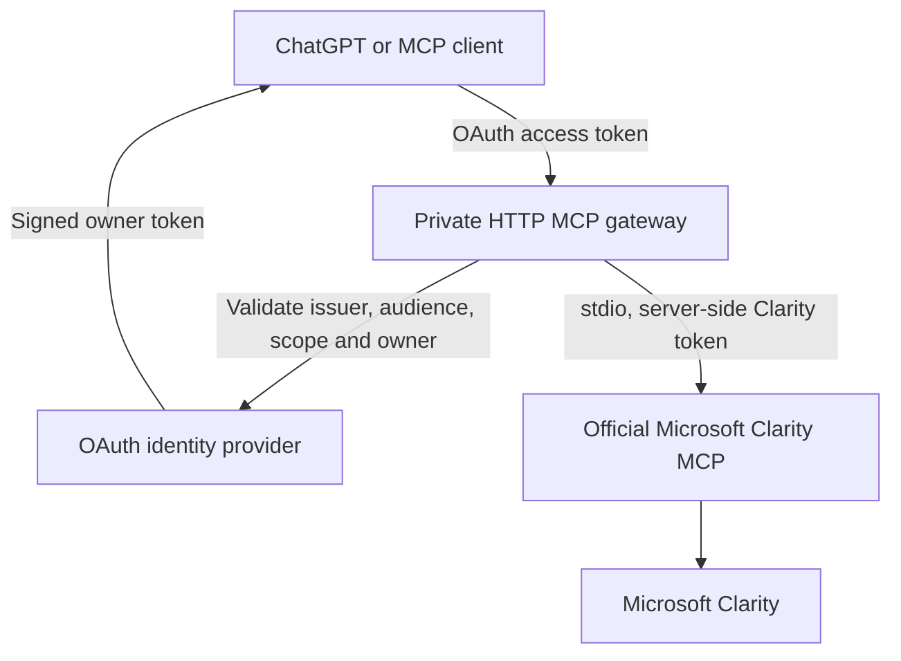

# Reid's Clarity MCP

A read-only bridge between MCP clients and Microsoft Clarity for **reidhslaughter.com**. The portfolio currently installs Clarity project **kg4cvt3xg0** in `components/consent-banner.tsx`, after analytics consent.

This is a separate Node service inside the portfolio repository. It is **not a public analytics endpoint in the portfolio app**, and the portfolio's Vercel deployment does not start it. No credentials or real visitor data are included. Live Clarity access and a ChatGPT connection still require the setup below.

## Design



Zod is overridden to patched version `4.6.7` because the official package's Zod 3 dependency is flagged by GHSA-mrhx-c7xc-m3w5. Discovery and protocol tests pass with the override. Review this override when updating the official adapter.

The gateway exposes only the three tools shipped in Microsoft's published `@microsoft/clarity-mcp-server@2.0.1`:

| Tool | Use |
| --- | --- |
| `query-analytics-dashboard` | Ask focused analytics questions with explicit dates, including page/device comparisons and friction metrics when returned by Clarity. |
| `list-session-recordings` | Find recordings using dates, visited URLs, device types, rage/dead clicks and other official filters. Defaults to 20 results, maximum 250. |
| `query-documentation-resources` | Retrieve Clarity's own documentation snippets. |

Recording results are metadata and links. This does not promise video downloads, replay rendering, heatmap image export, or arbitrary historical retention. Analytics availability depends on your project and Microsoft's endpoints. A result of no data is not evidence of zero visits. Consent affects what Clarity observes.

Microsoft's older Data Export REST endpoint documents 10 calls per project/day and a 1–3-day window. This bridge uses the newer official MCP tools and their endpoints; do **not** assume that the older REST limits or a particular date window describe all newer tools. Microsoft enforces its own quotas. A five-minute, bounded, in-memory cache coalesces identical calls and timestamps results; it is not a durable daily quota ledger. Prefer focused queries and avoid repeated exploratory calls.

## 1. Create the project credential

As the Clarity project admin, open project **kg4cvt3xg0** → **Settings → Data Export → Generate new API token**. Name it `reid-portfolio-mcp`. Save it in the server's secret manager as `CLARITY_API_TOKEN`.

The token selects the project; the public tracking ID alone cannot grant access, and the bridge cannot verify the token's project until a real query succeeds. Use the token from the specified project. Do not put it in chat, GitHub, browser JavaScript, `NEXT_PUBLIC_` variables, or MCP tool arguments. The official child receives it through its environment, not command-line arguments.

## 2. Local stdio option

Requires Node 22.12+:

```sh
cd integrations/clarity-mcp
npm ci --ignore-scripts
npm test
npm run check:upstream
```

`check:upstream` only starts the official adapter and lists its schemas. It does not verify a live credential or call the analytics service.

Set `CLARITY_API_TOKEN` through your client's secret configuration and register:

```json
{
  "mcpServers": {
    "reid-clarity": {
      "command": "node",
      "args": ["/absolute/path/to/portfolio-9b/integrations/clarity-mcp/src/stdio.mjs"]
    }
  }
}
```

The launched process must receive `CLARITY_API_TOKEN`. Local stdio has no HTTP listener and does not require OAuth. This is for clients that can launch local MCP processes; it does not itself connect a cloud ChatGPT session.

## 3. Remote endpoint for ChatGPT

Deploy this directory as a **single long-running container**, with TLS termination and HTTPS reachability from ChatGPT. Do not deploy it as a short-lived Vercel function: the official adapter is a persistent child process.

```sh
cd integrations/clarity-mcp
# After configuring secrets and OAuth below:
docker build -t reid-clarity-mcp .
docker run --rm --env-file .env -p 127.0.0.1:8787:8787 reid-clarity-mcp
```

For local configuration, copy `.env.example` to `.env`, restrict file permissions (`chmod 600 .env` on Unix), and fill it in. In hosted deployments use the hosting provider's secret store. Place a TLS reverse proxy in front of port 8787. Use `/healthz` for liveness only; it does not test Clarity credentials. The MCP URL is `https://YOUR_HOST/mcp`.

Required OAuth configuration:

1. Use an OAuth provider with authorization-code + **PKCE S256**, discovery metadata, JWT access tokens, and either predefined client registration, CIMD, or DCR supported by the ChatGPT connection UI. This service validates tokens; it does not implement its own identity provider or password database.
2. Register the MCP resource using the **exact** `MCP_RESOURCE_URL`, ending in `/mcp`. Configure the provider to handle the OAuth `resource` parameter and issue that URL as the access token's `aud` value.
3. Create the `clarity:read` scope. Set `OAUTH_ISSUER` to the exact issuer claim (including any trailing slash) and `OAUTH_JWKS_URL` to its trusted HTTPS signing-key endpoint. RS256 and ES256 are supported. Access tokens require `exp`, `iat`, `sub`, and a space-delimited `scope` claim.
4. Put your account's exact provider `sub` in `OAUTH_ALLOWED_SUBJECTS`. A valid token for any other account is rejected. This deployment shares one Clarity project, so do not add unrelated accounts.
5. Register the **exact callback URI shown by ChatGPT's connection setup** with the provider; do not use wildcard redirects. If using a predefined OAuth client, configure its client ID/secret in the connection setup, not this gateway.
6. Set all variables in `.env.example` in the host's secrets/configuration. It refuses to start without the token, issuer, JWKS, resource URL and owner allowlist.
7. In the ChatGPT plugin/custom MCP connection setup available to your account, add `https://YOUR_HOST/mcp`, choose OAuth, complete owner sign-in, and enable the tools. The gateway advertises discovery at `/.well-known/oauth-protected-resource/mcp` and in its 401 challenge. The identity provider must serve its own OAuth/OIDC discovery.

No public endpoint or OAuth provider has been provisioned by this commit. Actual connection depends on host access, identity-provider configuration and your Clarity secret. There is intentionally no unauthenticated or shared-password fallback.

## First live verification

After connecting, make one focused call, such as:

> Show traffic to reidhslaughter.com for the last 3 days, broken down by device.

Check that the returned project/page data matches your portfolio. Then try:

> Find up to 10 mobile sessions that visited `/projects/fleet-fuel-integration` between [explicit UTC start] and [explicit UTC end] and had dead clicks.

A successful first query establishes live access; mocked tests and `/healthz` do not. Live first-query verification remains pending until credentials and hosting are configured.

## Operation and security

- Every HTTP MCP request—including discovery of tools—requires verified OAuth authentication. Public routes expose only health and OAuth resource metadata.
- No arbitrary upstream URLs, project overrides, writes, or credential-setting tools. The adapter version and dependencies are locked.
- Requests are body-size limited; analytics queries are length limited. Recording dates/counts are validated. Official tool schemas perform the remaining parameter validation.
- Upstream calls time out after 45 seconds. No automatic retry loop. Errors and child stderr are not forwarded to clients/logs. Do not enable body/header logging in the proxy.
- Only configured browser origins are allowed. Server-to-server requests without an Origin header still require OAuth. Set `MCP_ALLOWED_ORIGINS` only for exact origins you actually need.
- Returned titles, URLs and visitor-derived strings are untrusted content, not instructions. Data stays in memory, with a maximum 64 cached query responses and a 2 MB result cap. It is not written to the repository.
- Run one instance. Multiple replicas have independent caches/rate gates. If scaling, add a shared cache/quota store first.
- Revoke access by removing an allowed subject or revoking the Clarity token. Already-issued JWTs are verified locally and remain valid until expiry unless the subject is removed; configure short-lived access tokens and provider refresh-token rotation.
- Neither MCP credentials nor connection configuration change the site's visitor-consent behavior. The separately served Fleet app is not automatically instrumented by adding this bridge.

## Validation

`npm test` uses a mock upstream and real signed test JWTs. It exercises authenticated HTTP MCP initialization, tool discovery/calls, owner and scope rejection, wrong audience, expiry, origin rejection, cache coalescing, input bounds, and error redaction. `npm run check:upstream` additionally confirms the pinned official adapter's tool inventory without spending live API calls.

Sources checked 2026-10-26:
- [Microsoft's official MCP implementation](https://github.com/microsoft/clarity-mcp-server)
- [Clarity Data Export token setup and REST limits](https://learn.microsoft.com/en-us/clarity/setup-and-installation/clarity-data-export-api)
- [OpenAI MCP OAuth requirements](https://developers.openai.com/plugins/build/auth)
